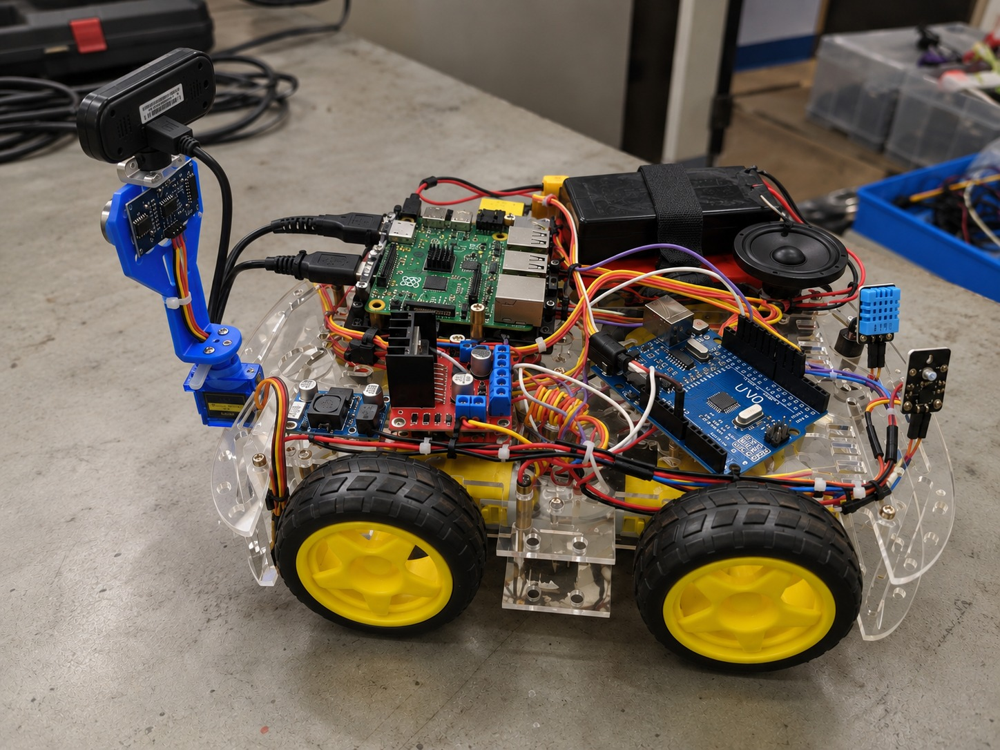
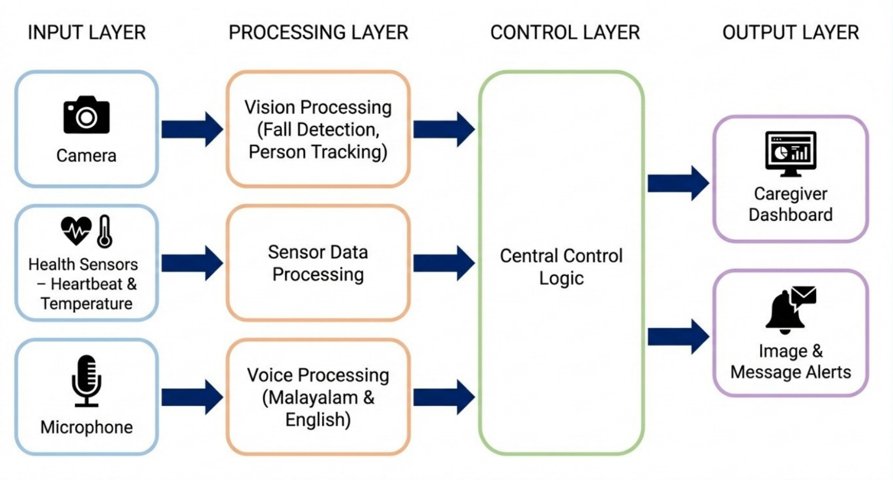
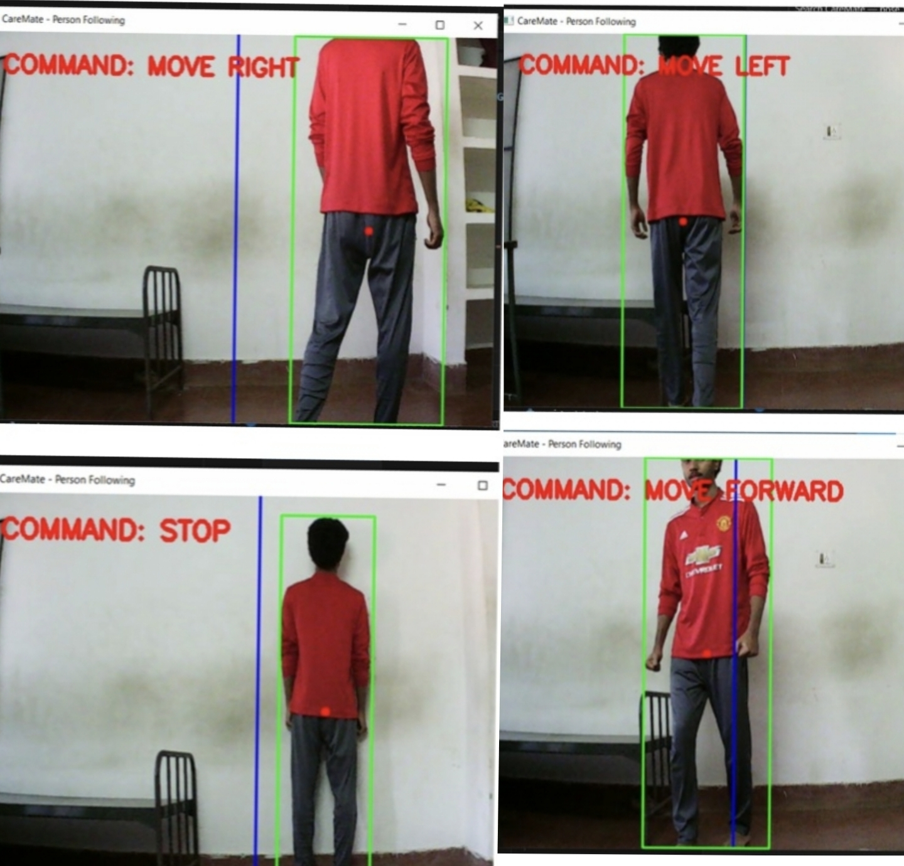
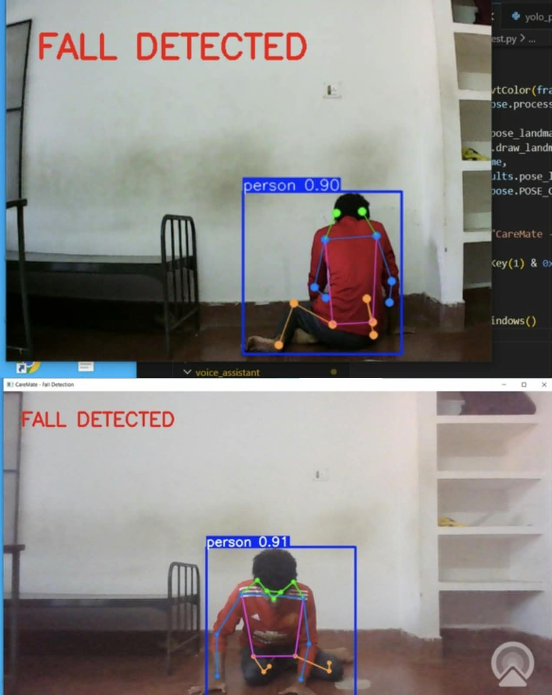
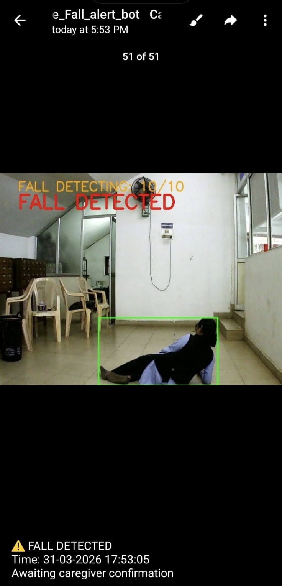
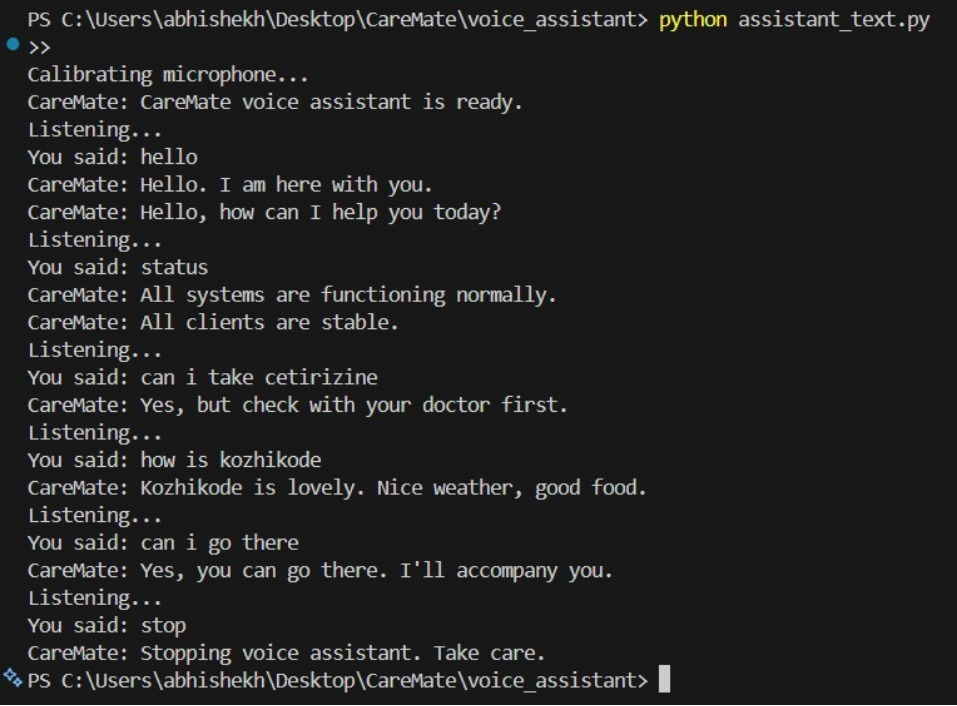
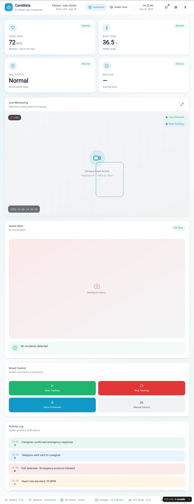
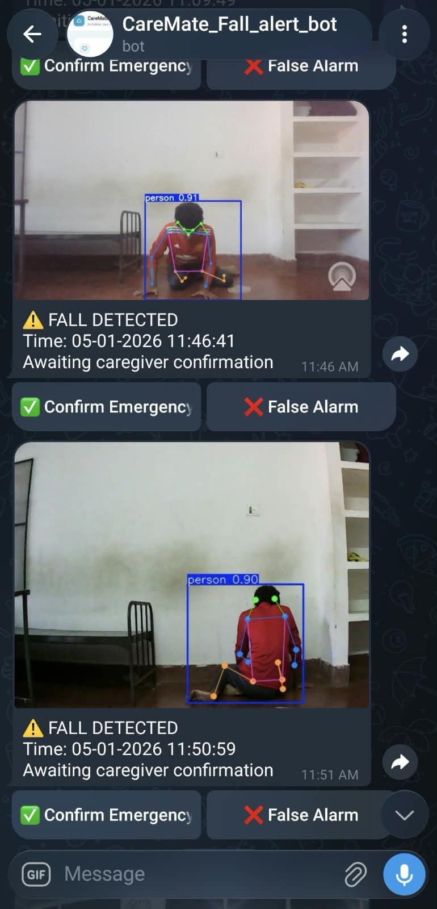
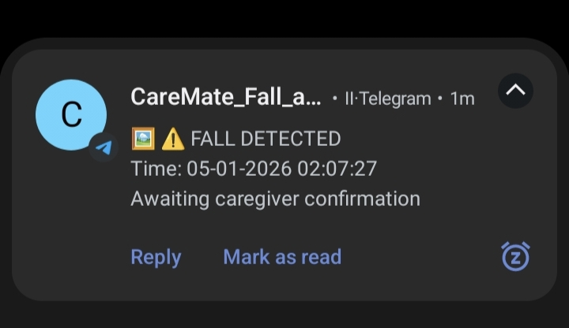
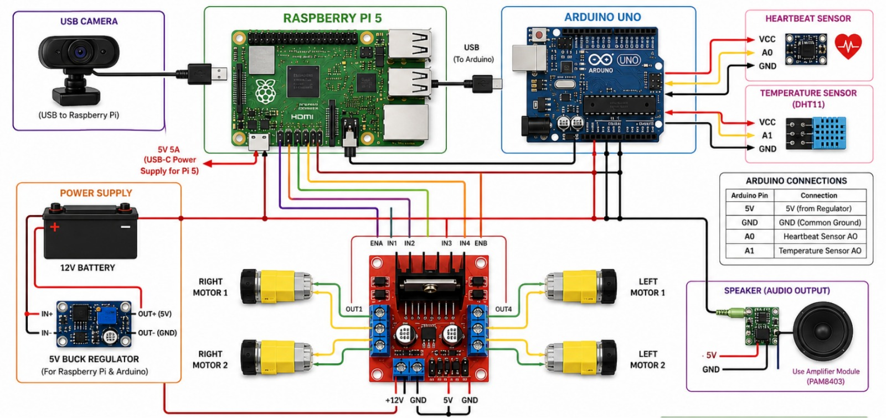

# CareMate — AI-Powered Elderly Care Companion Robot

<p align="center">
  
</p>

<p align="center">
  <strong>An AI-assisted mobile robotic platform for elderly safety, monitoring, interaction, and caregiver support.</strong>
</p>

<p align="center">
  <a href="https://www.python.org/"></a>
  <a href="https://www.raspberrypi.com/"></a>
  <a href="https://www.arduino.cc/"></a>
  
  
  
  
</p>

<p align="center">
  <strong>Group 15 · MES Kuttippuram · Guided by Mr. Abin C Jose</strong>
</p>

---

## Table of Contents

- [Overview](#overview)
- [Problem Statement](#problem-statement)
- [What CareMate Does](#what-caremate-does)
- [System Architecture](#system-architecture)
- [Core Modules](#core-modules)
- [Computer Vision](#computer-vision)
- [Health Monitoring](#health-monitoring)
- [Bilingual Voice Assistant](#bilingual-voice-assistant)
- [Caregiver Dashboard](#caregiver-dashboard)
- [Telegram Alert Workflow](#telegram-alert-workflow)
- [Hardware](#hardware)
- [Hardware Architecture](#hardware-architecture)
- [Pi ↔ Arduino Communication](#pi--arduino-communication)
- [Safety Mechanisms](#safety-mechanisms)
- [Technology Stack](#technology-stack)
- [Repository Structure](#repository-structure)
- [Project Gallery](#project-gallery)
- [Demonstrations](#demonstrations)
- [Installation](#installation)
- [Configuration](#configuration)
- [Running CareMate](#running-caremate)
- [Running Individual Modules](#running-individual-modules)
- [Testing](#testing)
- [Observed Performance](#observed-performance)
- [Limitations](#limitations)
- [Future Improvements](#future-improvements)
- [Team](#team)
- [Disclaimer](#disclaimer)

---

## Overview

**CareMate** is an AI-powered elderly care companion robot that combines **computer vision, robotics, health sensing, voice interaction, web monitoring, and remote caregiver alerts** into a single mobile platform.

The project is designed around a simple principle:

> **A care robot should not only move — it should be able to observe, interpret, interact, assist, and notify a caregiver when human intervention may be required.**

CareMate brings together:

- 👁️ Vision-based person detection
- 🚶 Person following and movement control
- ⚠️ Vision-based fall detection
- ❤️ Heart-rate monitoring
- 🌡️ Temperature monitoring
- 🎙️ Malayalam and English voice interaction
- 🖥️ Web-based caregiver dashboard
- 📱 Telegram notifications with image evidence
- 🤖 Raspberry Pi + Arduino hybrid control
- 🛑 Hardware-level motor safety through heartbeat monitoring

The system uses a **Raspberry Pi 5** as the high-level computing platform and an **Arduino UNO** for sensor interfacing and motor control.

---

## Problem Statement

Elderly people, particularly those living alone, can face situations where immediate assistance is unavailable.

Common challenges include:

- Falls and accidents
- Delayed caregiver response
- Difficulty continuously monitoring basic health parameters
- Limited mobility of conventional monitoring systems
- Difficulty interacting with technology during emergencies
- Lack of continuous environmental observation

Many existing solutions address only one part of the problem — for example, a wearable health sensor, a fixed camera, or a mobile application.

CareMate explores a more integrated approach by combining **mobility, computer vision, health sensing, voice interaction, and caregiver communication** on one robotic platform.

---

## What CareMate Does

At a high level, CareMate follows this workflow:

```text
                    ┌──────────────────────┐
                    │       USER           │
                    │  Elderly Individual  │
                    └──────────┬───────────┘
                               │
              ┌────────────────┼────────────────┐
              │                │                │
              â–¼                â–¼                â–¼
           Camera           Sensors           Voice
              │                │                │
              └────────────────┼────────────────┘
                               â–¼
                    ┌──────────────────────┐
                    │    RASPBERRY PI 5    │
                    │                      │
                    │ Vision + AI          │
                    │ Voice Processing      │
                    │ System Coordination  │
                    └──────────┬───────────┘
                               │
                         USB / Serial
                               │
                               â–¼
                    ┌──────────────────────┐
                    │     ARDUINO UNO      │
                    │                      │
                    │ Sensor Interface     │
                    │ Motor Control        │
                    │ Safety Heartbeat     │
                    └───────┬───────┬──────┘
                            │       │
                            â–¼       â–¼
                         Sensors  Motors
                            │
                            â–¼
                    ┌──────────────────────┐
                    │   CAREGIVER LAYER    │
                    │                      │
                    │ Dashboard + Telegram │
                    └──────────────────────┘
```

---

# System Architecture

CareMate is organized into four functional layers.

### 1. Sensing Layer

Collects information from the physical environment and the user:

- USB camera
- Pulse/heart-rate sensor
- DHT11 temperature sensor
- Microphone

### 2. Intelligence Layer

Runs on the Raspberry Pi:

- YOLOv8 person detection
- YOLOv8 pose estimation
- Fall detection logic
- Person-following logic
- Voice recognition
- LLM-assisted response generation
- System coordination

### 3. Control Layer

The Arduino UNO handles:

- Sensor interfacing
- Motor commands
- L298N motor-driver control
- Serial communication
- Hardware heartbeat safety stop

### 4. Caregiver Layer

Provides remote visibility and alerts:

- Flask dashboard
- Live camera stream
- Health readings
- Fall status
- Robot controls
- Activity log
- Telegram notifications
- Caregiver emergency confirmation

---

## System Architecture Diagram

<p align="center">
  
</p>

---

# Core Modules

| Module | Purpose | Main Technology |
|---|---|---|
| `module_01_person_following` | Detect and follow the target person | YOLOv8n + OpenCV |
| `module_02_fall_detection` | Detect potential falls from body posture | YOLOv8n-pose |
| `module_03_health_monitoring` | Read and monitor heart rate and temperature | Arduino + Python |
| `module_04_voice_assistant` | Malayalam/English voice interaction | SpeechRecognition + Groq + gTTS |
| `module_05_dashboard_alerts` | Monitoring dashboard and notifications | Flask + Telegram |
| `full_system` | Integrate all modules | Python + threading |
| `arduino_main` | Motor, sensor, and safety control | Arduino C/C++ |

---

# Computer Vision

Computer vision is one of the primary intelligence components of CareMate.

The camera feed is processed on the Raspberry Pi for:

- Person detection
- Person localization
- Person following
- Pose estimation
- Fall detection
- Visual monitoring

The project uses lightweight YOLOv8 models intended for edge deployment.

---

## Person Detection & Following

The person-following module uses **YOLOv8n** to detect people in the camera frame.

The implementation:

1. Captures a camera frame.
2. Detects objects belonging to the `person` class.
3. Selects the largest detected person bounding box as the target.
4. Filters very small detections.
5. Calculates the person's position relative to the frame center.
6. Determines a movement command.
7. Sends the command to the Arduino through serial communication.

```text
Camera Frame
     │
     â–¼
YOLOv8n Person Detection
     │
     â–¼
Target Bounding Box
     │
     â–¼
Position / Distance Estimation
     │
     â–¼
Movement Decision
     │
 ┌───┼───────────────┐
 â–¼   â–¼               â–¼
LEFT FORWARD       RIGHT
     │
     â–¼
   STOP
     │
     â–¼
Arduino → L298N → Motors
```

### Movement Commands

| Command | Meaning |
|---|---|
| `F` | Forward |
| `B` | Backward |
| `L` | Left |
| `R` | Right |
| `S` | Stop |

<p align="center">
  
</p>

---

# Fall Detection

Fall detection is a core safety feature of CareMate.

The system uses **YOLOv8n-pose** to obtain human pose information and combines it with geometric posture analysis.

### Detection logic

The implementation evaluates:

- Person bounding-box aspect ratio
- Head-to-hip relative position
- Minimum detection dimensions
- Consecutive frames satisfying fall conditions
- Alert cooldown

A potential fall is not immediately treated as a confirmed emergency.

```text
Camera Frame
     │
     â–¼
YOLOv8n-Pose
     │
     â–¼
Person + Pose Keypoints
     │
     ├───────────────┐
     â–¼               â–¼
Bounding Box     Keypoint Analysis
Aspect Ratio     Head / Hip Position
     │               │
     └───────┬───────┘
             â–¼
       Fall Candidate
             │
             â–¼
   Consecutive Frame Check
             │
             â–¼
      FALL CONFIRMED
             │
      ┌──────┴──────┐
      â–¼             â–¼
   Snapshot      Telegram Alert
```

The implementation currently confirms a fall after the configured number of consecutive frames and applies an alert cooldown to avoid repeated notifications.

<p align="center">
  
</p>

---

## Fall Alert Evidence

When a fall is confirmed, CareMate captures a snapshot and can send it to the caregiver through Telegram.

<p align="center">
  
</p>

---

# Health Monitoring

CareMate uses the Arduino UNO to interface with basic physiological/environmental sensors.

### Heart Rate

A pulse sensor provides heart-rate readings to the Arduino.

### Temperature

A DHT11 sensor provides temperature readings.

The Arduino periodically transmits the readings to the Raspberry Pi as JSON:

```json
{
  "hr": 72,
  "temp": 36.5,
  "hum": 60.0,
  "status": "ok"
}
```

The Python health-monitoring module:

- Reads the serial stream
- Parses sensor data
- Maintains the latest readings
- Logs readings to CSV
- Checks configured thresholds
- Generates health alerts when required
- Makes readings available to the dashboard

---

# Bilingual Voice Assistant

CareMate includes a voice assistant designed for **English and Malayalam** interaction.

### Voice pipeline

```text
Microphone
    │
    â–¼
Speech Recognition
    │
    â–¼
English / Malayalam Text
    │
    â–¼
Command / LLM Processing
    │
    â–¼
Response Text
    │
    â–¼
gTTS
    │
    â–¼
Audio Playback
```

The assistant supports local commands such as:

- Status
- Stop
- Help
- Call caregiver
- Emergency

Other conversational queries can be processed using the configured Groq LLM integration.

<p align="center">
  
</p>

> Voice responses are intended as an assistive interaction layer and should not be treated as professional medical advice.

---

# Caregiver Dashboard

CareMate provides a Flask-based web dashboard for centralized monitoring.

The dashboard includes:

- ❤️ Heart-rate information
- 🌡️ Temperature information
- 🚨 Fall status
- 📹 Live camera feed
- 🤖 Manual robot controls
- 🚶 Person-following control
- 📋 Activity log
- 📡 System status
- 🔔 Alert information

The dashboard is accessible over the local network:

```text
http://<raspberry-pi-ip>:5000
```

<p align="center">
  
</p>

---

# Telegram Alert Workflow

Telegram is used as the remote caregiver notification layer.

A confirmed fall can trigger:

1. Snapshot capture
2. Telegram photo notification
3. Event timestamp
4. Caregiver confirmation buttons

```text
Potential Fall
      │
      â–¼
Fall Confirmation Logic
      │
      â–¼
Snapshot Captured
      │
      â–¼
Telegram Photo Alert
      │
      â–¼
┌───────────────────────┐
│   CAREGIVER RECEIVES  │
│       ALERT           │
└───────────┬───────────┘
            │
       ┌────┴─────┐
       â–¼          â–¼
   CONFIRM      FALSE ALARM
       │          │
       â–¼          â–¼
Emergency      Dismiss
Response       Alert
```

<p align="center">
  
</p>

<p align="center">
  
</p>

---

# Human-in-the-Loop Safety

CareMate is designed so that AI detection assists rather than blindly replaces human judgment.

```text
AI Detection
     │
     â–¼
Potential Fall
     │
     â–¼
Caregiver Notification
     │
     â–¼
Human Confirmation
     │
 ┌───┴───────────┐
 â–¼               â–¼
Emergency      False Alarm
Response       / Dismiss
```

This design is particularly important because vision-based systems can experience false positives and false negatives under changing environmental conditions.

---

# Hardware

The physical CareMate prototype uses a mobile four-wheel robotic platform.

### Main components

| Component | Role |
|---|---|
| Raspberry Pi 5 | High-level processing and AI |
| Arduino UNO | Sensor and motor interfacing |
| L298N Motor Driver | DC motor control |
| USB Webcam | Vision input |
| 4 × DC Geared Motors | Robot movement |
| DHT11 | Temperature sensing |
| Pulse Sensor | Heart-rate sensing |
| 12V Battery | Motor power |
| 5V Buck Converter | Regulated low-voltage power |
| Speaker / Audio Output | Voice responses |

<p align="center">
  
</p>

---

# Hardware Architecture

The robot follows a split architecture:

- **Raspberry Pi:** high-level AI, vision, voice, communication, and system coordination
- **Arduino:** low-level sensors, motor control, and hardware safety
- **L298N:** motor-driver interface
- **12V battery:** primary motor power
- **5V buck converter:** regulated logic power

<p align="center">
  
</p>

### Simplified architecture

```text
                    USB CAMERA
                        │
                        â–¼
                 ┌─────────────┐
                 │ Raspberry Pi│
                 │      5      │
                 └──────┬──────┘
                        │
                   USB / Serial
                        │
                        â–¼
                 ┌─────────────┐
                 │ Arduino UNO │
                 └──────┬──────┘
                        │
              ┌─────────┴─────────┐
              â–¼                   â–¼
        Health Sensors       L298N Driver
              │                   │
              │             ┌─────┴─────┐
              │             ▼           ▼
              │         Left Motors  Right Motors
              │
              └──────► Sensor Data
```

---

# Hardware Wiring

## L298N → Arduino UNO

| L298N | Arduino | Purpose |
|---|---|---|
| ENA | D6 (PWM) | Left motor speed |
| IN1 | D7 | Left motor direction |
| IN2 | D8 | Left motor direction |
| ENB | D5 (PWM) | Right motor speed |
| IN3 | D9 | Right motor direction |
| IN4 | D10 | Right motor direction |

## DHT11 → Arduino UNO

| DHT11 | Arduino |
|---|---|
| VCC | 5V |
| GND | GND |
| DATA | D2 |

## Pulse Sensor → Arduino UNO

| Pulse Sensor | Arduino |
|---|---|
| VCC | 5V |
| GND | GND |
| Signal | A0 |

## Raspberry Pi → Arduino

The Raspberry Pi communicates with the Arduino through USB serial.

Default configuration:

```text
/dev/ttyACM0
9600 baud
```

---

# Pi ↔ Arduino Communication

CareMate uses a simple serial protocol between the Raspberry Pi and Arduino.

## Raspberry Pi → Arduino

| Data | Meaning |
|---|---|
| `F` | Move forward |
| `B` | Move backward |
| `L` | Turn left |
| `R` | Turn right |
| `S` | Stop |
| `K` | Heartbeat acknowledgement |

## Arduino → Raspberry Pi

| Data | Meaning |
|---|---|
| `H` | Heartbeat, approximately every 1 second |
| JSON sensor packet | Health data, approximately every 2 seconds |

Example:

```json
{"hr":72,"temp":36.5,"hum":60.0,"status":"ok"}
```

---

# Safety Mechanisms

### Arduino Heartbeat Safety Stop

The Arduino expects periodic heartbeat acknowledgements from the Raspberry Pi.

```text
Raspberry Pi
     │
     │ K
     │
     â–¼
Arduino
     │
     │ heartbeat timeout
     â–¼
No acknowledgement for 3 seconds
     │
     â–¼
STOP ALL MOTORS
```

If the Arduino does not receive the expected `K` heartbeat within the configured timeout, it automatically stops the motors.

This provides a hardware-level fail-safe against loss of Raspberry Pi communication.

### Other safety/robustness mechanisms

- Fall confirmation over multiple frames
- Fall-alert cooldown
- Health-alert cooldown
- Minimum person bounding-box size
- Motor diagnostic test before person following
- Manual stop control
- Caregiver confirmation for fall alerts

---

# Technology Stack

## Hardware

- Raspberry Pi 5
- Arduino UNO
- L298N motor driver
- USB webcam
- DC geared motors
- DHT11
- Pulse sensor
- 12V battery
- 5V buck converter
- Robotic chassis
- Speaker/audio output

## Software & AI

- Python
- OpenCV
- Ultralytics YOLOv8
- YOLOv8n
- YOLOv8n-pose
- NumPy
- Flask
- PySerial
- SpeechRecognition
- gTTS
- Pygame
- Groq API
- Telegram Bot API
- Arduino C/C++

---

# Repository Structure

```text
CAREMATE/
│
├── README.md
├── .gitignore
├── .env.example
├── config.py
├── requirements.txt
│
├── arduino_main/
│   └── caremate_arduino.ino
│
├── assets/
│   ├── dashboard/
│   ├── demo/
│   │   ├── caremate-demo.mp4
│   │   └── fall-detection-demo.mp4
│   ├── hardware/
│   ├── hero/
│   ├── images/
│   │   ├── caremate-robot.jpg
│   │   ├── dashboard.jpg
│   │   ├── fall-detection-alert.jpg
│   │   ├── fall-detection.jpg
│   │   ├── hardware-architecture.jpg
│   │   ├── person-following.jpg
│   │   ├── system-architecture.jpg
│   │   ├── telegram-alert.jpg
│   │   ├── telegram-notification.jpg
│   │   └── voice-assistant.jpg
│   └── vision/
│
├── docs/
│
├── full_system/
│   ├── main.py
│   ├── shared_state.py
│   └── README.md
│
├── models/
│
├── module_01_person_following/
│   ├── person_following.py
│   ├── test_motors.py
│   └── README.md
│
├── module_02_fall_detection/
│   ├── fall_detection.py
│   └── README.md
│
├── module_03_health_monitoring/
│   ├── health_monitor.py
│   ├── arduino_health/
│   │   └── arduino_health.ino
│   └── README.md
│
├── module_04_voice_assistant/
│   ├── voice_assistant.py
│   └── README.md
│
└── module_05_dashboard_alerts/
    ├── app.py
    ├── telegram_bot.py
    ├── templates/
    │   └── index.html
    └── README.md
```

---

# Project Gallery

## Physical Prototype

<p align="center">
  
</p>

## Hardware Architecture

<p align="center">
  
</p>

## System Architecture

<p align="center">
  
</p>

## Fall Detection

<p align="center">
  
</p>

## Person Following

<p align="center">
  
</p>

## Voice Assistant

<p align="center">
  
</p>

## Dashboard

<p align="center">
  
</p>

---

# Demonstrations

## CareMate Robot Demonstration

[â–¶ Open CareMate Demo](assets/demo/caremate-demo.mp4)

## Fall Detection Demonstration

[â–¶ Open Fall Detection Demo](assets/demo/fall-detection-demo.mp4)

> GitHub's handling of large MP4 files can vary. The repository keeps the original demonstration files under `assets/demo/`; if GitHub does not render an inline preview, open the file using the links above.

---

# Installation

CareMate is primarily designed for deployment on a **Raspberry Pi running Linux**, with an Arduino UNO connected through USB.

## 1. Clone the Repository

```bash
git clone https://github.com/Abhishek-palakkeel/CAREMATE.git
cd CAREMATE
```

## 2. Create a Virtual Environment

```bash
python3 -m venv .venv
source .venv/bin/activate
```

On Windows:

```powershell
.venv\Scripts\activate
```

## 3. Install Python Dependencies

On the Raspberry Pi:

```bash
pip install -r requirements.txt --break-system-packages
```

If your environment does not require `--break-system-packages`, the standard command is:

```bash
pip install -r requirements.txt
```

## 4. Install Required System Packages

```bash
sudo apt update
sudo apt install espeak portaudio19-dev mpg321
```

## 5. Install the Arduino Library

Open the Arduino IDE and install:

**DHT sensor library by Adafruit**

Then:

1. Open `arduino_main/caremate_arduino.ino`
2. Select **Arduino UNO**
3. Select the correct serial port
4. Upload the sketch

---

# Configuration

Before running CareMate, configure the central `config.py` file.

Important configuration values include:

```python
TELEGRAM_BOT_TOKEN = "YOUR_BOT_TOKEN_HERE"
TELEGRAM_CHAT_ID   = "YOUR_CHAT_ID"

SERIAL_PORT        = "/dev/ttyACM0"
BAUD_RATE          = 9600

CAMERA_INDEX       = 0

GROQ_API_KEY       = "YOUR_GROQ_API_KEY_HERE"
```

### Important

**Never commit real API keys, Telegram bot tokens, passwords, or other credentials to GitHub.**

Use placeholder values in the public repository and keep private credentials out of version control.

---

# Download YOLO Models

The project uses two lightweight YOLOv8 models:

- `yolov8n.pt` — person detection
- `yolov8n-pose.pt` — pose estimation / fall detection

Download them with:

```bash
python3 -c "
from ultralytics import YOLO
YOLO('yolov8n.pt')
YOLO('yolov8n-pose.pt')
print('Models downloaded.')
"
```

The models may also be downloaded automatically by Ultralytics when loaded if they are not already present.

---

# Running CareMate

## Recommended startup sequence

### 1. Connect Arduino

Connect the Arduino UNO to the Raspberry Pi through USB.

### 2. Test the motors

**Do this before running person following.**

```bash
cd module_01_person_following
python test_motors.py
```

The diagnostic checks:

```text
FORWARD
STOP
BACKWARD
STOP
LEFT
STOP
RIGHT
STOP
```

If a motor rotates in the wrong direction, inspect the corresponding motor wiring.

### 3. Start the complete system

```bash
cd full_system
python main.py
```

The integrated system launches:

```text
Vision Thread
Health Monitoring Thread
Voice Assistant Thread
Flask Dashboard Thread
Arduino Serial / Heartbeat Management
```

### 4. Open the dashboard

From another device on the same network:

```text
http://<raspberry-pi-ip>:5000
```

---

# Running Individual Modules

Each subsystem can also be tested independently.

| Module | Command |
|---|---|
| Person Following | `cd module_01_person_following && python person_following.py` |
| Motor Test | `cd module_01_person_following && python test_motors.py` |
| Fall Detection | `cd module_02_fall_detection && python fall_detection.py` |
| Health Monitoring | `cd module_03_health_monitoring && python health_monitor.py` |
| Voice Assistant | `cd module_04_voice_assistant && python voice_assistant.py` |
| Dashboard | `cd module_05_dashboard_alerts && python app.py` |
| Telegram Test | `cd module_05_dashboard_alerts && python telegram_bot.py` |

---

# Testing

CareMate was tested across the major functional areas.

### Computer Vision

- Person detection
- Pose/keypoint detection
- Fall detection
- Person tracking
- Direction estimation

### Robotics

- Forward movement
- Backward movement
- Left movement
- Right movement
- Stop command
- Person-following behaviour

### Health Monitoring

- Heart-rate input
- Temperature input
- Serial JSON parsing
- Threshold-based alerts
- Health data logging

### Voice

- Voice input
- English recognition
- Malayalam recognition
- Command recognition
- System responses
- Stop command
- Caregiver/emergency command

### Communication

- Telegram text alert
- Telegram photo alert
- Caregiver confirmation
- False-alarm handling

### Dashboard

- Live camera stream
- Health information
- Fall status
- Robot controls
- Activity logs
- System status

---

# Observed Performance

Testing and project review observations showed:

- Real-time fall detection using pose estimation
- Reliable person detection and tracking under suitable lighting conditions
- Telegram alert delivery in approximately 1–2 seconds during testing
- Voice assistant responses in approximately 1–2 seconds during testing
- Raspberry Pi edge processing suitable for the implemented lightweight models

Performance is environment-dependent and should not be interpreted as a medical or production-grade benchmark.

---

# Limitations

CareMate is an **academic and engineering prototype**, and several limitations remain.

### Computer Vision

- Performance depends on lighting conditions.
- Full occlusion can cause tracking loss.
- Fast movement can reduce tracking stability.
- Vision-based fall detection can produce false positives or false negatives.

### Voice

- Recognition accuracy can decrease with background noise.
- Malayalam recognition depends on speech clarity and acoustic conditions.
- Internet/API availability can affect LLM-assisted responses.

### Hardware

- Motor behaviour depends on surface conditions, battery state, and mechanical alignment.
- Sensor readings depend on placement, calibration, and sensor quality.
- The prototype does not yet provide production-grade autonomous navigation.

### Connectivity

- Telegram notifications require network connectivity.
- The caregiver dashboard is intended for the local network deployment used by the prototype.

### Medical Use

CareMate is **not a certified medical device** and should not be used as a replacement for professional medical equipment, emergency services, or human supervision.

---

# Future Improvements

## Robotics

- Autonomous navigation
- Obstacle avoidance
- Wheel encoders
- LiDAR/depth sensing
- Mapping and localization
- Better path planning
- Automatic return-to-user behaviour

## Computer Vision & AI

- Temporal fall-detection models
- Improved false-positive reduction
- Multi-person tracking
- Activity recognition
- Behaviour anomaly detection
- Personalized monitoring

## Health Monitoring

- Additional physiological sensors
- Improved sensor calibration
- Historical health trends
- Long-term data visualization
- More robust alert classification

## Voice Assistant

- Stronger offline speech recognition
- Improved Malayalam support
- Context-aware conversations
- Personalized interaction
- More robust noisy-environment recognition

## Caregiver Platform

- Historical dashboards
- Mobile application
- Multiple caregiver accounts
- Alert severity levels
- Emergency escalation
- Cloud synchronization where appropriate

---

# Design Philosophy

CareMate is not intended to be just a mobile robot.

The broader design goal is to combine:

```text
        ┌──────────────┐
        │    SAFETY    │
        └──────┬───────┘
               │
        ┌──────▼───────┐
        │   CAREMATE   │
        └──────┬───────┘
               │
      ┌────────┼────────┐
      │        │        │
      â–¼        â–¼        â–¼
   HEALTH  ASSISTANCE  AI
      │        │        │
      └────────┼────────┘
               │
               â–¼
          CAREGIVER
```

The project explores how **AI perception, embedded systems, robotics, natural interaction, and remote communication** can work together to create a more proactive elderly-care platform.

---

# Team

| Member | Responsibility |
|---|---|
| **Abhishekh P** | Vision & System Lead |
| **Ranila CP** | Voice Assistant Developer |
| **Reeha Al Samar** | Dashboard & UI Developer |
| **Hiba Shamsudheen** | IoT & Documentation Lead |

**Institution:** MES Kuttippuram  
**Project:** Group 15  
**Guide:** Mr. Abin C Jose

---

# Disclaimer

CareMate is an academic/engineering prototype developed for research, learning, demonstration, and evaluation purposes.

It is **not a certified medical device, emergency response system, or substitute for professional healthcare**.

Fall detections, health readings, voice responses, and caregiver alerts may be affected by environmental conditions, sensor limitations, network availability, and model accuracy. Critical situations must always be independently verified by a responsible human or appropriate emergency/medical service.

---

## Acknowledgements

The project makes use of open-source software, machine-learning frameworks, embedded platforms, and hardware technologies including Python, OpenCV, Ultralytics YOLO, Flask, Arduino, Raspberry Pi, and related libraries and services.

---

<p align="center">
  <strong>CAREMATE</strong><br>
  AI · Robotics · Computer Vision · Embedded Systems · Elderly Care
</p>

